# qmk_config

Personal QMK configuration for a Kyria v2.1 with an Adafruit KB2040 (RP2040)
controller in each half. The Kyria keymap lives in
`keyboards/splitkb/kyria/keymaps/helmecke/`, the shared userspace in
`users/helmecke/`. The removal of unreachable configuration and retired
features, with the resulting validation, is recorded under
[Verification status](#verification-status).

## Build

### Toolchain and checkout

The firmware is built with upstream QMK. Stage this repository into a QMK
checkout rather than symlinking it:

```bash
git clone https://github.com/qmk/qmk_firmware.git
cd qmk_firmware
git checkout 8252b6309752f0be6882c387e15989ba51323d8f
git submodule update --init --recursive \
    lib/chibios lib/chibios-contrib lib/pico-sdk lib/lufa lib/googletest lib/printf

/path/to/qmk_config/tests/stage-into-qmk.sh "$PWD"
```

If the script is not executable on your platform, run it with `bash
/path/to/qmk_config/tests/stage-into-qmk.sh "$PWD"`.

`tests/stage-into-qmk.sh` copies `users/helmecke`, the Kyria keymap and the
fixtures under `tests/` into the checkout. Nothing is symlinked and no QMK
sources are modified. The six submodules above are what the RP2040 build and
the fixtures need: `lib/lufa` for the LL-style USB headers, `lib/printf` for the
fixtures' logging, `lib/googletest` for the fixtures themselves.

The recorded builds used QMK master
`8252b6309752f0be6882c387e15989ba51323d8f` and the container image
`ghcr.io/qmk/qmk_cli:latest`, digest
`sha256:b7d7fa8fb4432b569931de5ad59098cb788f440ed61a62c5126746b71aee0f4a`.

### Commands

The KB2040 needs `CONVERT_TO=kb2040`. Without it QMK would resolve
`splitkb/kyria/rev2` to its `base` variant (Elite-C/AVR) and build the wrong
target. The converter selects `MCU=RP2040`, `BOARD=QMK_PM2040` and
`BOOTLOADER=rp2040`, with `SERIAL_DRIVER=vendor` and `WS2812_DRIVER=vendor`.

Full-feature build (OLED, encoders, underglow, Cirque, Caps Word):

```bash
make splitkb/kyria/rev2:helmecke CONVERT_TO=kb2040 -j2
```

Console-disabled verification build (OS application must not depend on console
logging):

```bash
make splitkb/kyria/rev2:helmecke CONVERT_TO=kb2040 CONSOLE_ENABLE=no -j2
```

In the QMK container on Windows, from the checkout:

```bash
docker run --rm \
  -v "C:/path/to/qmk_firmware:/qmk_firmware" \
  -w /qmk_firmware -e SKIP_GIT=yes \
  ghcr.io/qmk/qmk_cli:latest \
  make splitkb/kyria/rev2:helmecke CONVERT_TO=kb2040 -j2
```

The build writes:

- `.build/splitkb_kyria_rev2_base_helmecke_kb2040.uf2` (deployment image)
- `.build/splitkb_kyria_rev2_base_helmecke_kb2040.elf` (debug image)
- `splitkb_kyria_rev2_base_helmecke_kb2040.uf2` in the checkout root

### Flash

Both halves run the same firmware: handedness comes from the matrix
(`split.handedness.matrix_grid` in `keyboard.json`), not from EEPROM, so the
same UF2 is copied to each half and the `uf2-split-left`/`uf2-split-right`
variants are not needed.

1. Enter the bootloader without the reset button: hold the left **backspace
   thumb** key (or the right **space thumb** key) so the `_SYM`/`_NUM` layer
   engages, then tap the thumb key to its right. Those positions map to `U_RST`
   (`QK_BOOT`). Double-tapping the KB2040 reset button works too.
2. Copy the UF2 to the `RPI-RP2` drive, or run
   `make splitkb/kyria/rev2:helmecke:flash CONVERT_TO=kb2040`.
3. Repeat for the other half.

This image was flashed and exercised on the hardware; see the verification
status below for what was and was not covered.

## Keymaps



The seven layers are diagrams of `keymaps[]` in the keymap file, drawn with
[keymap-drawer](https://github.com/caksoylar/keymap-drawer) from
`docs/kyria_helmecke.yaml`: [all layers and the legend](docs/README.md).
Center is the tap, the bottom legend the hold (mod-tap or layer-tap), the top
legend Shift, the bottom-right corner an AltGr key override, `·` a transparent
key.

The YAML is a hand-maintained mirror of the keymap expansion, so it has to be
updated together with `keymap.c` or the row macros in
`users/helmecke/definitions/keymap_blocks.h`; `bash docs/render-keymaps.sh`
redraws the SVGs. Encoders, key overrides and Caps Word have no key position
and are documented in `docs/README.md` instead.

## Hardware configuration

Effective settings, as resolved by the recorded build:

| Function | Setting | Source |
| -------- | ------- | ------ |
| Matrix and encoders | `rev2/base` matrix pins, one encoder per half, rotated on the right | `keyboards/splitkb/kyria/rev2/base/keyboard.json` |
| Split serial | Pro Micro `D2` → KB2040 `GP1`, vendor (PIO) serial driver | `keyboard.json`, converter default |
| I2C bus | `I2CD1` (RP2040 I2C1), SDA = `D1` → `GP2`, SCL = `D0` → `GP3` | `QMK_PM2040` board defaults, inherited |
| OLED and Cirque | Share the I2C bus; no repo-level RP2040 I2C overrides | Kyria keymap config/rules, board defaults |
| RGB underglow | `WS2812` on Pro Micro `D3` → `GP0`, vendor driver, 20 LEDs split 10/10 | `keyboard.json`, converter default |
| OLED | 128x64 SSD1306, rotation 180°, status screen on the only display; no OLED on/off sync; layer and lock state synced to the peripheral half | `rev2/config.h`, keymap config, keymap code |
| Cirque | 40 mm Pinnacle on I2C, right side, tap and secondary tap, gesture scroll, curved overlay | Kyria keymap `config.h`/`rules.mk` |
| USB side | Either half may be USB; `SPLIT_USB_DETECT`, `SPLIT_USB_TIMEOUT 4000`, `NO_USB_STARTUP_CHECK` | Kyria keymap `config.h` |

The Cirque reports locally when the right half is the USB half and forwards
movement, buttons and scroll when the left half is central. Left-half USB
operation is confirmed by typing and display checks; the Cirque itself could not
be exercised in this session because its connector and ribbon cable are missing.

### OLED

Only the left half has a display. The left half renders the status screen (OS
logo, board name, layer, lock state) regardless of which half is the USB half,
so the screen is usable in both orientations. `SPLIT_OLED_ENABLE` is deliberately
undone: it is generated from the Kyria `info.json` and forwards the USB half's
on/off state, which is always "off" when that half has no display and therefore
switched the left display off. Each half now drives its own display and timeout;
activity on either half wakes it because the matrix state is synced.

The `CapsWord: on` line appears only while the **left** half is the USB half.
Caps Word state exists on the USB half alone; the peripheral shows a blank line
rather than a stale value. Syncing it would need a custom split RPC transaction
(not implemented). The OS logo uses the OS synchronized over the split
transport when the left half is the peripheral, so it still shows the real host.
The display uses the 60 s OLED inactivity timeout (not the 5 s Caps Word
timeout).

## Caps Word

Caps Word is QMK's built-in feature, enabled only for the Kyria keymap
(`CAPS_WORD_ENABLE = yes`). The shared userspace contributes a German-aware
policy (`users/helmecke/features/caps_word_german.c`) only when the feature is
enabled, so other boards do not gain Caps Word.

Activation is QMK's native both-Shifts gesture: hold left and right Shift
together and release one of them. With the home-row Shift mod-taps hold `D` and
`K` past the preserved 200 ms tapping term, then release; explicit `LSFT`/`RSFT`
keys on other layers and one-shot Shift work the same way (plain and mod-tap
Shift pairs activate in either release order, one-shot shifts in QMK's tested
order, left first). Ordinary `D`/`K` taps still type letters, and an individual
hold still acts as Shift.

While active:

- Letters are shifted, including the umlaut keys.
- The German minus key types `_`; digits stay unchanged; backspace and delete
  keep editing the word; underscore continues it.
- Momentary layers and layer-tap keys keep working.
- AltGr umlauts type `Ä`, `Ö`, `Ü`; AltGr+S types `SS` (two `S` keystrokes, so
  backspace deletes one `S` at a time). Outside Caps Word AltGr+S still types
  `ß`.
- AltGr+`.` (`!`), AltGr+`,` (`?`), an ordinary comma, space, Shift, shortcuts
  and five seconds of inactivity end the word.
- The mode never toggles host Caps Lock, forces a layer, or leaves modifiers
  stuck. `CAPS_WORD_INVERT_ON_SHIFT` is deliberately disabled: pressing Shift
  ends the word first, so Shift+`/` keeps its ordinary output afterwards.

The four outer corner keys are dedicated German keys: top-left ä, top-right ü,
bottom-left ß and bottom-right ö. With Caps Word active they type Ä/Ö/Ü, and the
ß key types SS (two S keystrokes, so Backspace removes one S). The minus key from
the old top-right position is available as `DE_MINS` on the symbol layer.

### Comma

`,` is a plain `DE_COMM` key. Every press types exactly one comma: repeated
presses are repeats, and holding it types the comma on the press without sending
End or waiting for a tapping term. An ordinary comma ends Caps Word on the press
itself; AltGr+`,` afterwards activates the `?` key override, which QMK processes
after Caps Word.

## Host OS detection

QMK detects the host from USB fingerprinting and reports it after a debounce.
`process_detected_host_os_user()` in `users/helmecke/helmecke.c` applies it
once, and every consumer reads the same applied value:

- Windows, Linux and unknown hosts: no Ctrl/GUI swap.
- macOS and iOS: Ctrl/GUI swap.

An unknown host is displayed as unknown rather than assumed to be Windows, and
typing keeps working. `SPLIT_DETECTED_OS_ENABLE` copies the detected value to the
peripheral half for its display.

Detection is a heuristic, not an identification: the host keyboard language is
not detected, and remote desktops or unusual USB hardware can defeat it. QMK
keeps detection state across a USB reconnect at this revision, so switching to a
different OS host may only be picked up after a keyboard reset; there is no
manual OS selector.

## Tests

`tests/README.md` describes the fixtures and how to stage and run them inside
upstream QMK:

```bash
make test:helmecke_caps_word
make test:helmecke_os
```

## Verification status

Two dated runs are recorded. The earlier one belongs to the source before the
cleanup and identifies the rollback image; the later one records the cleanup.
Old counts and hashes are history, not evidence for the current image.

### Pre-cleanup run (2026-11-17) — rollback identity

| Check | Result |
| ----- | ------ |
| Full-feature KB2040 build | Passed, UF2 produced, no warnings |
| Console-disabled KB2040 build | Passed, UF2 produced |
| Caps Word / punctuation / tap dance / key override fixtures | Passed (18 tests) |
| Host OS application fixtures, console-disabled | Passed (5 tests) |
| Flash, both halves, USB on either half | Passed; enumerate as composite HID, both matrices and both encoders work |
| Caps Word on hardware | Passed: `HELLO_WORLD123`, `ÄÖÜ`, `SS` in mode, AltGr `!`/`?` exits, comma/leader, quote/GUI, backspace, 5 s timeout |
| Dedicated corner keys | Passed: `ä` `ü` `ß` `ö` outside Caps Word, `Ä` `Ü` `SS` `Ö` in mode |
| OLED in both USB orientations | Passed: status screen, layer/locks, 60 s sleep and wake on either half (after the OLED sync fix below) |
| Underglow | Passed on hardware |
| Cirque | Blocked: connector and ribbon cable missing, so neither local nor forwarded pointing could be tested |
| USB-C dock, both halves | Not tested in this session |
| macOS/Linux hosts | Not tested (no hosts/input methods available) |

Character-level checks were written to a scratch file on the host and compared
byte for byte, so the reported strings are the actual HID output rather than a
visual impression. The OLED check covered the status screen, the layer line,
sleep after the 60 s timeout and wake from keys on either half.

That image has SHA-256
`59556fe8883b07caa02168d1ae53292c7c808c4d31fa9d08377a655f748904c3`. It is kept
outside this repository as the rollback artifact
`kyria-kb2040-helmecke-pre-cleanup.uf2`, so a half can be returned to the last
fully validated behaviour.

### Cleanup run (2026-11-18)

| Check | Result |
| ----- | ------ |
| Full-feature KB2040 build | Passed, UF2 produced, no compiler warnings |
| Console-disabled KB2040 build | Passed, UF2 produced, no compiler warnings |
| Caps Word / punctuation / key override fixtures | Passed (18 tests) |
| Host OS application fixtures, console-disabled | Passed (5 tests) |
| Flash, both halves, same firmware | Passed; both matrices type and the left OLED shows the OS logo and layer name |
| Remaining layers, both encoders | Passed: QWERTY, NAV, NUM, SYM, FUN, MOUSE and ADJUST are reachable; volume works on both halves |
| Former debug slot on `_ADJUST` | Passed: it is transparent and types `b`; `U_DBG` on its own slot still toggles console debug |
| Plain comma | Passed: single, double and triple presses type 1/2/3 commas, a hold types one comma with no End, and the following letter is not swallowed |
| AltGr punctuation | Passed: AltGr+`,` types `?` and AltGr+`.` types `!` |
| Caps Word | Passed: `HELLO_WORLD123`, `ÄÖÜ`, `SS`, comma exits the word on the press, quote/GUI work, the 5 s timeout ends it |
| Not re-checked | Underglow wiring, the Cirque, the USB-C dock, the 60 s OLED sleep/wake and the opposite USB orientation; the 2026-11-17 run stands for them because this change cannot affect them |
| macOS/Linux hosts | Not tested (no hosts available) |

Hardware checks were run on both halves with the same image, as required by the
renumbered layers. The Cirque remains untestable while its connector and ribbon
cable are missing; pointing behaviour is therefore still unvalidated.

The full-feature image has SHA-256
`780ea86f953153504d3aac16944dacf72ce38697b04d608d4a390a97a091a344`; the
console-disabled variant has
`eba543f2e2ba9b83cc81f53384a25e99b1caf2ce9d6257b9180f72a2f12ab86c`. Both are
kept outside this repository next to the rollback artifact. Rebuilding the same
configuration reproduces each image; the two variants differ because console
support changes the compiled output.

### OLED sync fix found during hardware validation

With the USB cable on the right half, the left display switched off. The cause
is `SPLIT_OLED_ENABLE`, which the Kyria `info.json` generates
(`split.transport.sync.oled`); the USB half has no display, so its synced state
is always "off" and the peripheral display was forced off. The keymap config now
`#undef`s it after the generated `info_config.h`. Sleep, wake and the status
screen were verified in both USB orientations afterwards.

## OLED troubleshooting notes (retained)

These notes are kept from the original README. They describe the problem that
was reproduced during hardware validation:

> Disable `SPLIT_OLED_ENABLE`, this syncs the status, but is wrong. It syncs it
> based on the on/off status, but it always returns false if there is no OLED.
> So you have to manually track and check. The best way is to also disable the
> OLED timeout and handle that yourself, track the timeout manually, and sync
> your own boolean over split custom data.

Applied correction: `SPLIT_OLED_ENABLE` is undone in the keymap config because
the Kyria `info.json` generates it, and the symptom (left display forced off when
the right half is the USB half) was reproduced on current QMK. The manual
timeout/boolean sync was not needed: each half now runs its own display timeout,
and activity waking works because the matrix state is synced. This was verified
on hardware in both USB orientations.

## Scope

- Only the Kyria v2.1 with KB2040 halves is maintained. The Iris keymap and the
  community-layout adapters are not part of this repository any more, so there
  is no second reachability root to keep in sync.
- No manual OS selector is provided; OS selection is automatic.
