# Keymap diagrams

Seven layers, drawn from `kyria_helmecke.yaml` with
[keymap-drawer](https://github.com/caksoylar/keymap-drawer) against the Kyria
rev2 physical layout in `kyria_rev2_layout.json` (a trimmed copy of
`keyboards/splitkb/kyria/rev2/info.json` from QMK master).

`kyria_helmecke.yaml` is maintained by hand and mirrors the expansion of
`keyboards/splitkb/kyria/keymaps/helmecke/keymap.c` plus the row macros in
`users/helmecke/definitions/keymap_blocks.h`. It is not generated from `qmk
c2json`: that output drops the `#define` names, reports the custom `U_*`
keycodes as numbers, and carries neither the key overrides nor the encoder map,
so the result would be unreadable and incomplete.

Regenerate after touching the keymap or the YAML:

```bash
python -m pip install --user keymap-drawer   # once
bash docs/render-keymaps.sh                  # all layers
bash docs/render-keymaps.sh QWERTY           # a single layer
```

The script writes `docs/keymaps/<layer>.svg`; styling lives in
`keymap_drawer.config.yaml`. The SVGs are committed, so the README shows the
current state without a build step.

## In the browser

The SVGs are standalone files: open `docs/keymaps/qwerty.svg` in a browser, or
read `docs/README.md` on GitHub, which renders them inline.

[keymap-drawer's web app](https://caksoylar.github.io/keymap-drawer) works too,
but needs two manual steps. `splitkb/kyria/rev2` is not part of the keyboard
metadata on `keyboards.qmk.fm`, so its keyboard picker cannot resolve the Kyria
and the physical layout has to be uploaded under "Layout override"
(`kyria_rev2_layout.json`). The YAML also carries no `layout:` field, because
`render-keymaps.sh` passes the layout with `-j`. Paste the contents of
`kyria_helmecke.yaml` and, if the styling should match, the contents of
`keymap_drawer.config.yaml` (without the comment header) into the config box,
then draw.

## Legend

| Position | Meaning |
| -------- | ------- |
| center | tap |
| bottom | hold: mod-tap, layer-tap or momentary layer |
| top | Shift |
| bottom-right corner | AltGr key override (see the table below) |
| `·` | transparent, falls through to the next active layer |
| `⌘` `⌥` `⇧` `⌃` | GUI, Alt, Shift, Ctrl |
| `AltGr` | the German AltGr modifier |

The symbols in the images are what the host receives on Windows and Linux. On
macOS several of them are reached through different chords, which is decided at
runtime by the host OS detection described in the top-level README.

## QWERTY



## NAV



## NUM



## SYM



## MOUSE



## FUN



## ADJUST



## Not in the diagrams

The drawings show `keymaps[][MATRIX_ROWS][MATRIX_COLS]` only. Everything below
is firmware behaviour that has no key position, so it is documented here.

**Key overrides** (`users/helmecke/features/key_override.c`), active on every
layer:

| Chord | Output |
| ----- | ------ |
| AltGr + `A` | `ä` |
| AltGr + `S` | `ß`, or `SS` while Caps Word is active |
| AltGr + `U` | `ü` |
| AltGr + `O` | `ö` |
| AltGr + `.` | `!` |
| AltGr + `,` | `?` |
| Shift + Alt + `Backspace` | `Delete` |

**Encoders** (`encoder_map` in `keymap.c`): one encoder per half, identical on
all seven layers. The two entries are volume down/up and previous/next track.

**The four unlabelled caps** next to the split are the extra key positions of
the rev2 matrix. The keymap leaves them transparent, so they type nothing.

**Caps Word** is core QMK behaviour, not a layer. See the Caps Word section of
the top-level README for the activation gesture, the timeout and the German
character rules. While Caps Word is on, the comma ends it on the press and the
AltGr override for `?` still applies.

**Tap-hold** is core QMK behaviour too, configured per keymap. Chordal Hold turns
same-hand overlaps of the home-row mod-taps into taps (thumbs and the AltGr keys
`X`/`.` are exempt), and Permissive Hold resolves the mod-taps as holds when the
chorded key is released before the tapping term. The thumb layer-taps are not
permissive. See the Tap-hold section of the top-level README.

**The OLED status screen** shows the OS logo, the board name, the highest active
layer and the host lock state; it is described in the top-level README.
